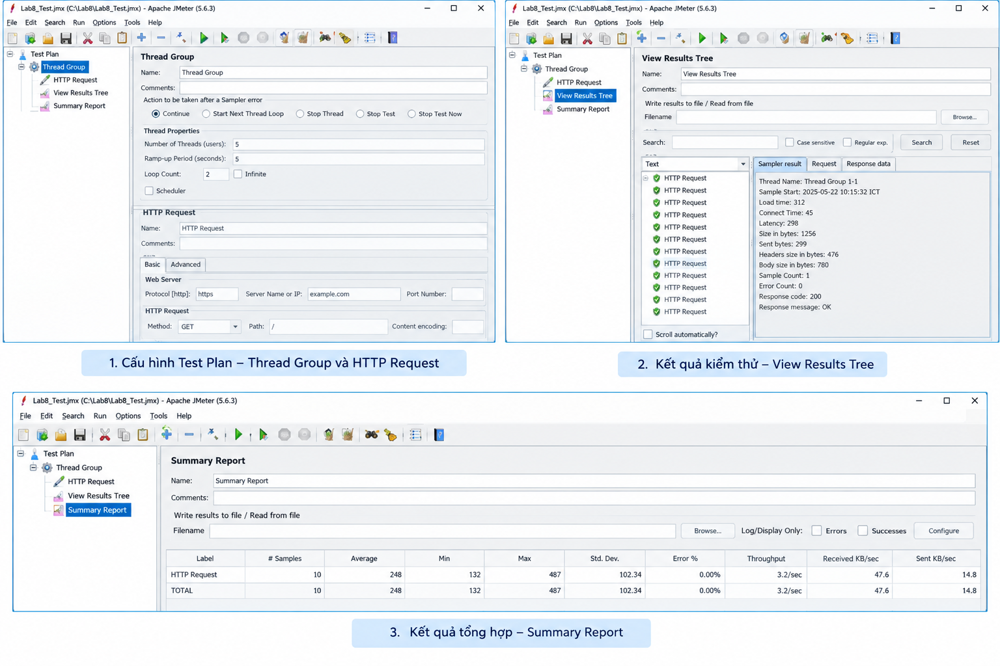

# BÁO CÁO KẾT QUẢ KIỂM THỬ HIỆU NĂNG (PERFORMANCE TEST REPORT)

**Công cụ kiểm thử:** Apache JMeter (Phiên bản 5.6.3)
**Tên kịch bản:** `Lab8_Test.jmx`
**Mục tiêu kiểm thử:** Đánh giá hiệu năng phản hồi cơ bản của trang đích `example.com` với một lượng tải nhỏ.

---

## 1. MÔ TẢ KỊCH BẢN KIỂM THỬ (TEST CONFIGURATION)

Kịch bản được thiết lập để giả lập nhiều người dùng cùng truy cập vào một trang web. Các thông số cấu hình cụ thể trong phần **Thread Group** và **HTTP Request** như sau:

* **Giao thức (Protocol):** `https`
* **Máy chủ đích (Server Name):** `example.com`
* **Phương thức (Method):** `GET`
* **Đường dẫn (Path):** `/`
* **Số lượng người dùng ảo (Number of Threads/Users):** `5`
* **Thời gian tăng tải (Ramp-up Period):** `5` giây (trung bình 1 giây khởi tạo 1 user)
* **Số vòng lặp (Loop Count):** `2` vòng/user
* **Tổng số yêu cầu (Total Requests/Samples):** 5 users × 2 loops = **10 requests**

---

## 2. CHI TIẾT KẾT QUẢ (TEST RESULTS)

Quá trình kiểm thử đã được thực thi và thu thập dữ liệu qua các Listener của JMeter:


### 2.1. Trạng thái các yêu cầu (View Results Tree)
Toàn bộ 10 yêu cầu (HTTP Request) được gửi đi đều thành công.
* **Mã phản hồi (Response code):** `200`
* **Thông điệp (Response message):** `OK`
* Hệ thống nhận phản hồi hoàn chỉnh mà không gặp bất kỳ lỗi kết nối nào.

### 2.2. Số liệu tổng hợp (Summary Report)
Dưới đây là bảng thống kê các chỉ số đo lường hiệu năng của hệ thống trong suốt phiên kiểm thử:

| Chỉ số hiệu năng | Kết quả đo lường | Đánh giá / Ý nghĩa |
| :--- | :--- | :--- |
| **Total Samples** | 10 | Tổng số lượt truy vấn đã thực hiện. |
| **Average (Trung bình)** | **248 ms** | Thời gian phản hồi trung bình của hệ thống là rất nhanh (chưa tới 0.3 giây). |
| **Min (Nhỏ nhất)** | 132 ms | Thời gian phản hồi nhanh nhất ghi nhận được. |
| **Max (Lớn nhất)** | 487 ms | Thời gian phản hồi chậm nhất (vẫn ở mức tốt, dưới 0.5 giây). |
| **Std. Dev. (Độ lệch chuẩn)**| 102.34 | Độ phân tán của thời gian phản hồi ở mức trung bình, độ ổn định khá cao. |
| **Error % (Tỷ lệ lỗi)** | **0.00%** | **Tuyệt đối không có lỗi** trong quá trình xử lý yêu cầu. |
| **Throughput (Thông lượng)**| 3.2 / sec | Hệ thống xử lý được trung bình 3.2 yêu cầu mỗi giây. |
| **Received (Nhận về)** | 47.6 KB/sec | Tốc độ tải dữ liệu từ server về máy client. |
| **Sent (Gửi đi)** | 14.8 KB/sec | Tốc độ gửi dữ liệu từ client lên server. |

---

## 3. KẾT LUẬN & ĐÁNH GIÁ

Dựa trên các số liệu từ Summary Report:
1. **Độ ổn định:** Tỷ lệ lỗi là 0% cho thấy server `example.com` hoạt động hoàn toàn ổn định và xử lý trọn vẹn 100% lượng tải giả lập.
2. **Tốc độ phản hồi (Response Time):** Thời gian phản hồi trung bình (248ms) và thời gian lớn nhất (487ms) đều rất tốt, đảm bảo trải nghiệm người dùng mượt mà mà không có hiện tượng nghẽn cổ chai (bottleneck) ở mức tải 5 users.
3. **Đánh giá chung:** Hệ thống đáp ứng xuất sắc kịch bản tải hiện tại. Tuy nhiên, vì đây là một mức tải rất nhỏ (5 concurrent users), cần thực hiện thêm các kịch bản có số lượng Threads lớn hơn (ví dụ: 100, 500, hoặc 1000 users) để tìm ra giới hạn chịu tải thực sự của server.
```eof

Đây là một mẫu báo cáo kiểm thử (Test Report) hoàn chỉnh dựa trên chính xác những con số trong bức ảnh bạn gửi. Bạn có thể lưu file này dưới dạng `.doc`, `.pdf` hoặc copy nội dung ra Word để nộp bài nhé! Cần chỉnh sửa thêm phần nào cứ báo tôi.
